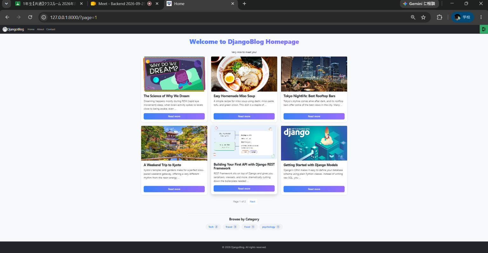
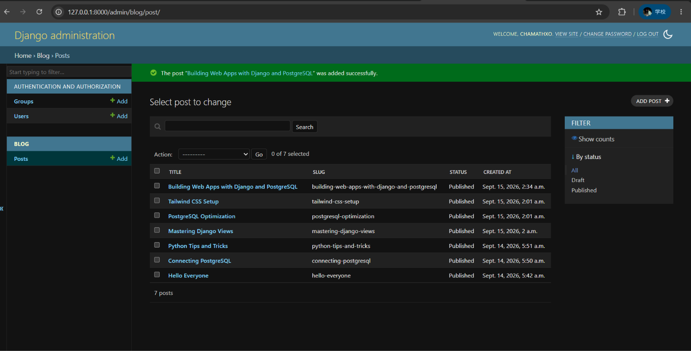

# DjangoBlog

A blog web app built with Django as a learning project.

## Features
- Create, edit, and delete posts with cover images
- Categories, tags, search, and pagination
- User registration, login, logout, and password reset
- Comments with replies, likes, and pinned comments
- User avatars and a "My Posts" page
- Custom 403, 404, and 500 error pages

## Setup
1. Clone the repo and create a virtual environment:
   `python -m venv venv` then `venv\Scripts\activate`
2. Install the packages: `pip install -r requirements.txt`
3. Create a `.env` file with SECRET_KEY, DB_NAME, DB_USER,
   DB_PASSWORD, DB_HOST, DB_PORT, DEBUG, ALLOWED_HOSTS
4. Run the migrations: `python manage.py migrate`
5. Start the server: `python manage.py runserver`

## Screenshots

